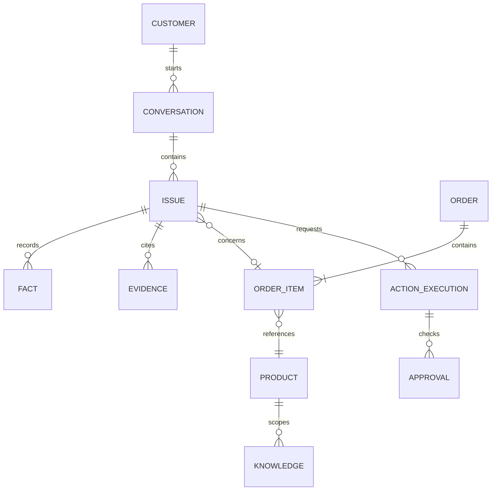
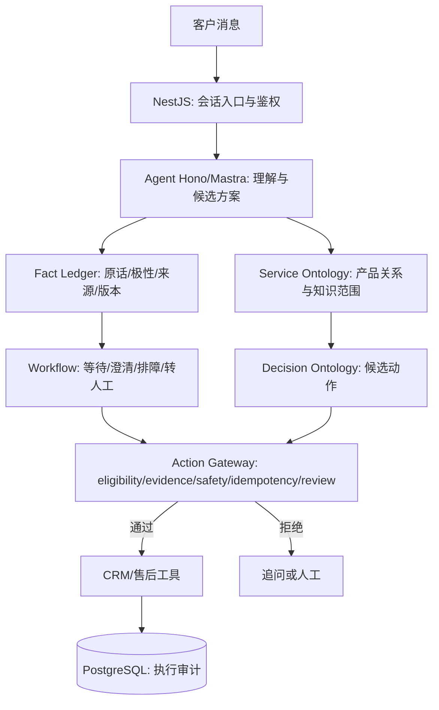

# 从双本体到可靠客服：架构备忘

## 一句话拆分

> Ontology = 世界里有什么、对象之间是什么关系、规则适用到哪里；Fact Ledger = 谁在什么时候提供了什么证据；Workflow = 当前正在做什么；Action Gateway = 此刻能否执行有副作用的动作。

## 推荐的领域关系

注意：订单号或商品关系不直接证明某位客户的身份或所有权；身份验证、授权读取与最小权限要独立设计。

## 分层与数据流

图示为推荐设计，不代表当前最小教学项目已经部署了 NestJS、Mastra、PostgreSQL 或 CRM。

## 五条业务不变量

1. 不能把仅凭名称猜测的产品当成已验证的产品；遇到同名产品应澄清。
2. 检索到相似文档，不意味着文档适用于当前 PN 或知识版本。
3. 用户明确更正事实后，旧事实必须可追溯，基于旧事实的待答卡片或候选方案必须重新校验。
4. 模型输出业务动作的建议，不能自动取得有副作用操作的执行权限。
5. 写操作超时不意味着失败；重试前必须通过幂等标识核实执行结果。外部系统如果不支持查询或幂等，应转人工/对账。

## 教学实现与生产系统的差距

| 项目 | 教学实现 | 产品化必须补齐 |
|---|---|---|
| 数据 | 内存、合成示例 | 租户隔离、加密、真实来源、持久化 |
| 用户身份 | 无 | 认证、RBAC、订单所有权确认 |
| 规则 | 演示状态逻辑 | 版本化政策、有效期、渠道和地区差异 |
| 执行 | 进程内 Map | PostgreSQL 唯一约束、事务、审计、后端幂等 |
| Agent | 未接入大模型 | 结构化输出、评测、超时/降级、独立审查 |
| 交付 | 静态 HTML | 可用性、可观测、监控、人工工作台 |

## 阅读源代码顺序

1. OntoCare `dataset.py` → `qa_workflows.py` → `app.py:resolve_product/allowed_actions`。
2. haike `conversation/interpret.py:FactCandidate` → `conversation/reduce.py:reduce_turn`。
3. haike `sessions/graph.py:build_graph` → `actions/review.py` → `actions/gate.py` → `actions/executor.py`。
4. 学会将每一种风险映射到一个可测试的不变量，再考虑选择复杂的 Agent 框架。
